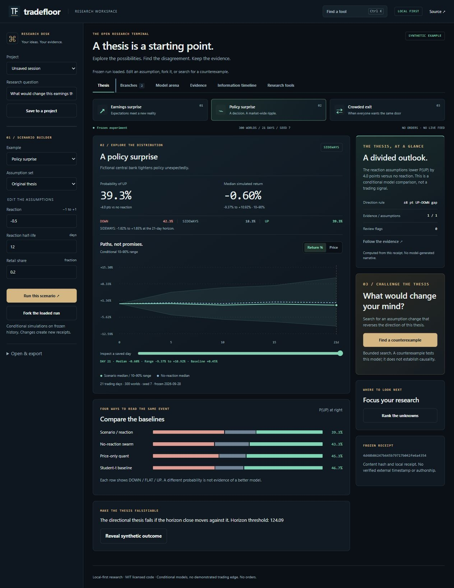
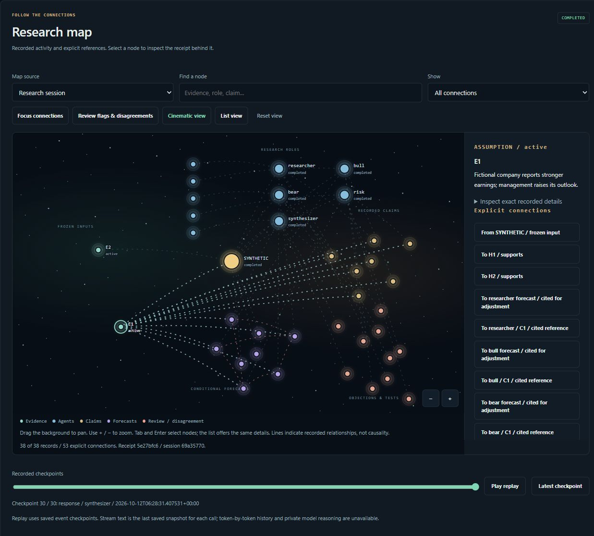
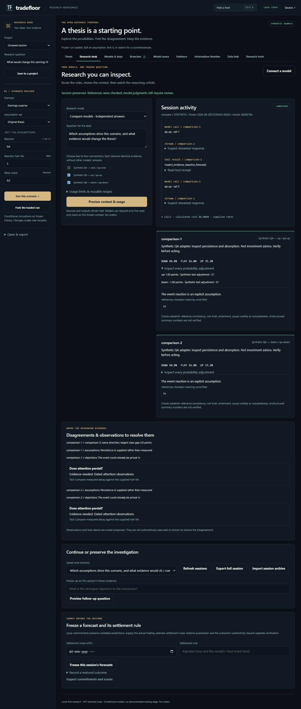
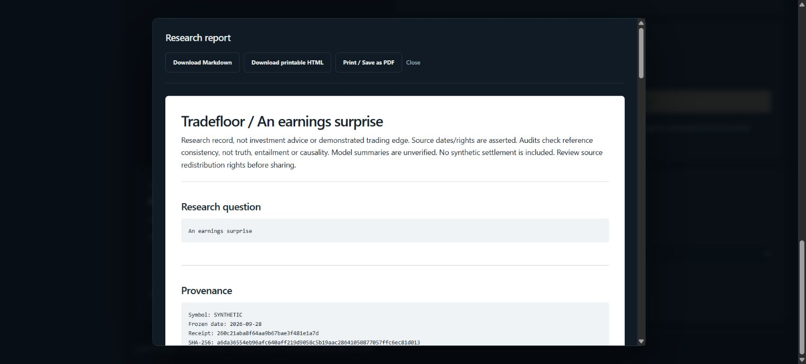
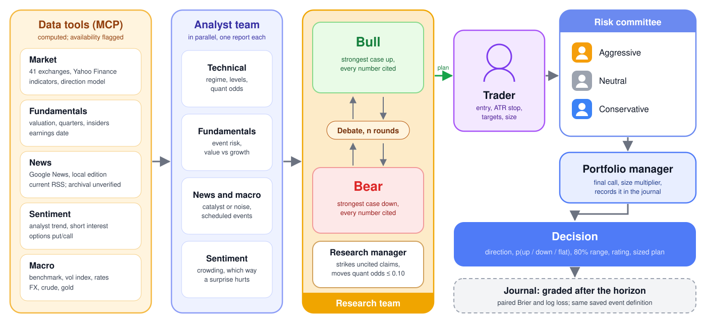
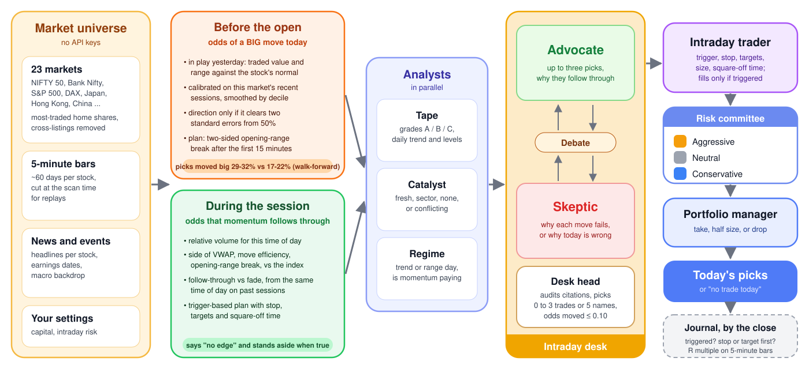
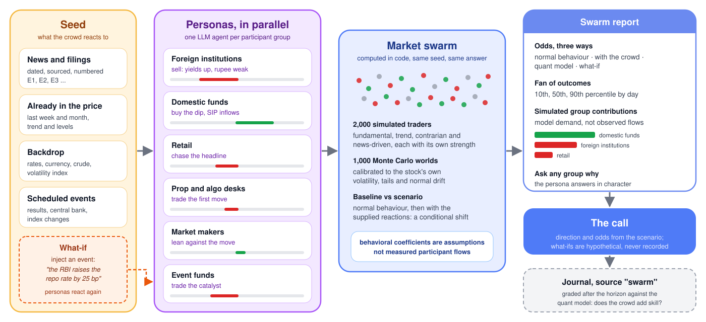
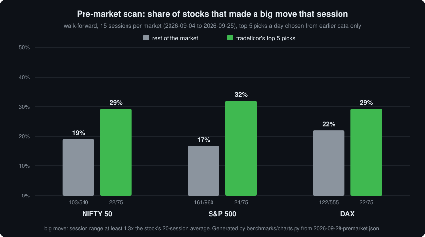

<p align="center">
  <picture>
    <source media="(prefers-color-scheme: dark)" srcset="assets/logo-dark.svg">
    
  </picture>
</p>

# Tradefloor

**An open financial research desk and scenario lab. Freeze an event, challenge its assumptions, fork the run, and keep score.**

Tradefloor combines deterministic market tools with agent research roles. Python computes
probabilities, validates decisions and scores defined outcomes. The scenario lab works
without an LLM, API key or signup.

Research software. No orders. No demonstrated trading edge. Version 0.5.0 adds a searchable
source library, reviewed document capture and cited reports, alongside user-selected
models, bounded research sessions and inspectable forecast adjustments to the local workspace.

[What's implemented](ROADMAP.md) ·
[Release verification](docs/release-readiness.md) ·
[Launch runbook](docs/launch-runbook.md)

[Browser workspace](#try-the-workspace) · [Claude Code](#use-with-claude-code) ·
[Codex](#use-with-codex) · [Functions](#capabilities) · [CLI / MCP](#terminal-and-mcp)

## Try the workspace

**[Open the live synthetic demo](https://himanshuj16.github.io/tradefloor/)** - no signup,
API keys or installation. Choose an event, challenge its assumptions, inspect the research
map and export a cited report. Real sources and user-selected models run in the local workspace.

Requires [uv](https://docs.astral.sh/uv/) and Python 3.11+ (uv can provision Python).

```bash
git clone https://github.com/HimanshuJ16/tradefloor
cd tradefloor
uv run --project server tradefloor-demo
```

Open **http://127.0.0.1:8765**. Choose an earnings surprise, policy surprise or crowded exit.
Save a project, change the reaction assumptions and fork it on identical history. Search
for a counterexample, compare branches and models, inspect evidence dependencies, then
reveal a held-out **synthetic** outcome. Projects retain branches, evidence and revision history.

Switch the chart between returns and prices, inspect saved simulation days, and read the
UP / SIDEWAYS / DOWN breakdown alongside the baseline shift. Press **Ctrl+K** (Windows/Linux)
or **Cmd+K** (macOS) to find workspace views and research actions. On mobile, expand
**Project & assumptions** to edit the scenario.

<p align="center"></p>

*Interface preview using synthetic fixtures; the displayed odds are not a market-performance claim.*

### Bring your own research models

Open **Models & keys** to save a model ID, API base URL and connection protocol.
Tradefloor supports streaming OpenAI-compatible Chat Completions and Anthropic Messages,
including compatible local Ollama/LM Studio servers and gateways. Compatibility depends
on the endpoint and model; a connection test makes one small, potentially billable call.

Keys use the OS credential store (Windows, macOS or Linux Secret Service), or a named
environment variable in the local server. They are excluded from browser storage and
session archives. On headless systems without an OS vault, use an environment variable.
The desk does not inherit a Claude Code, Codex or ChatGPT subscription.

In **Research desk**, choose Quick, Balanced, Deep, an independent model comparison or
a single research question. Assign connections to the roles, set usage limits and select
**Preview context & usage**. Inspect the frozen evidence and destinations before starting.
The session records streamed responses, read-only tool receipts, citation/numeric-reference
checks, probability adjustments, objections and proposed observations to resolve disagreements.

The **Research map** connects frozen evidence, agents, tool receipts, claims and forecasts.
Select a node to inspect its records; search, filter, focus, pan or zoom the graph. Replay
saved session checkpoints, highlight forecast disagreements, or use the keyboard-accessible
list on mobile. An optional cinematic view adds restrained motion and respects reduced motion.
Preview an evidence withdrawal to trace dependent references, then explicitly create a child
scenario with that input retracted. Numerical assumptions remain unchanged; new model research
requires a separate preview and Start.

<p align="center"></p>

*Real browser capture with synthetic QA adapters. Connections represent recorded references
and activity, not private model reasoning, causality or demonstrated forecasting skill.*

Save configurations as recipes, reopen sessions, ask follow-up questions and export complete
research archives. Freeze validated forecasts with a future settlement rule and record
matured supplied outcomes for descriptive Brier/log-loss and reliability summaries.
**Data hub** imports bounded daily CSV history, captures supported market history, and
configures SEC/ALFRED connections. See [workspace contracts](docs/workspace.md) for limits.

<p align="center"></p>

*Real browser capture using a controlled synthetic test adapter. These are not real language-model forecasts or evidence of predictive skill.*

The fictional fixtures demonstrate settlement, not predictive skill. The UI runs 300
worlds with 200 simulated traders over 21 days. Behavioral coefficients and participant
shares are assumptions. Evidence links do not establish causality.

Create a single HTML demo that works without a backend:

```bash
uv run --project server tradefloor-demo --export dist/demo/index.html
```

It contains 21 frozen runs: seven assumption sets per event. Its precomputed forks refer
to each original thesis. Persistent projects, custom inputs and research jobs require the
local workspace. The static demo labels unavailable operations. See the
[workspace guide](docs/workspace.md) and [extension contracts](docs/extensions.md).

## From source to cited research

Open **Sources & reports** in the local workspace. Import UTF-8 text, Markdown, HTML or a
text-based PDF, or discover recent SEC filings and explicitly capture a selected public
document. Supply original publication/availability dates and data rights. The local library
preserves original-byte and extracted-text hashes and ranks exact passages with BM25.

Review and select the passages, then **Freeze selected passages into a branch**. Sources
with unknown or later availability cannot enter that historical scenario. Numerical
assumptions stay unchanged. Preview the new context in Research desk before sending it to
your models. Document instructions are untrusted source data.

Build a **cited research report** from the loaded scenario or selected model session.
Download Markdown or printable HTML, or choose **Print / Save as PDF** in your browser.
The report includes forecast structures, audit flags, unresolved observations and an exact
source appendix. It excludes synthetic settlement and future paths. Review redistribution
rights before sharing. Scanned PDFs require a verified text transcription; OCR is not bundled.

<p align="center"></p>

The standalone demo offers fictional source inspection and report export. Real document
imports, source requests and model calls require the local workspace.

## Use with Claude Code

Tradefloor includes a Claude Code plugin with seven research skills, analyst agent
definitions and the same 64 MCP tools used by the CLI. Install
[Claude Code](https://code.claude.com/docs/en/overview) and
[uv](https://docs.astral.sh/uv/), sign in to Claude Code, then run these commands from
the **Tradefloor repository root**:

```bash
uv sync --project server --locked
claude --plugin-dir .
```

This loads the current checkout for that session. Inside Claude Code, start with an
offline synthetic example:

```text
/tradefloor:lab earnings
```

For a persistent installation, run the following **inside Claude Code**, replacing
the example with the absolute path to your checkout. Quote paths containing spaces:

```text
/plugin marketplace add "/absolute/path/to/tradefloor"
/plugin install tradefloor@tradefloor
```

Start a new session after installation. Use `/mcp` to check that the Tradefloor server
connects. See [Claude's plugin documentation](https://code.claude.com/docs/en/plugins)
for local loading and installation behavior.

| Claude Code command | Function | Data needed |
|---|---|---|
| `/tradefloor:lab earnings` | Simulate an event, inspect assumptions, fork and replay frozen runs | Synthetic fixtures; no market-data key |
| `/tradefloor:direction AAPL 1m` | Quick numerical direction forecast | Provider access |
| `/tradefloor:analyze RELIANCE.NS 1m` | Analyst research, bull/bear debate, trade plan and risk review | Provider access |
| `/tradefloor:scout nifty 50 quick` | Scan a market for pre-market or live intraday candidates | Provider access |
| `/tradefloor:swarm AAPL` | Explore conditional participant reactions and compare with a baseline | Provider access |
| `/tradefloor:scan AAPL MSFT INFY.NS` | Compare instruments in a watchlist | Provider access |
| `/tradefloor:review` | Review recorded calls and available outcome scores | Local journal; provider access for fresh outcomes |

The host orchestrates the research roles; Python computes the numerical results. The
number of model calls and their cost depend on the selected skill and host plan.

## Use with Codex

Tradefloor includes portable plugin metadata, a Codex compatibility manifest, skills and
an MCP server. Install Codex and uv, sign in, and open the Tradefloor checkout. Choose
one of the following setup paths to avoid registering the same server twice.

**MCP setup from this checkout:** run these commands in a terminal at the repository root:

```bash
uv sync --project server --locked
uv run --project server python tools/install.py codex --dry-run
uv run --project server python tools/install.py codex
```

The installer registers the local server in `~/.codex/config.toml` (or the directory
selected by `CODEX_HOME`). It preserves unrelated configuration, backs up the existing
file before its first change and uses an absolute checkout path. Keep that checkout in
place, or rerun the installer after moving it. Start a new Codex session to load the server.

This path adds MCP tools. It does not install plugin skills globally. Within this
repository, Codex can also follow `AGENTS.md` and the files under `skills/`.

**Full plugin setup:** on Codex CLI versions with plugin commands, run from the repository
root instead of using the MCP installer:

```bash
codex plugin marketplace add .
codex plugin add tradefloor@tradefloor
```

Start a new session after installation. The plugin bundles both skills and MCP tools.
Local plugin installation and discovery can vary by Codex surface; see the
[official plugin documentation](https://developers.openai.com/plugins/build/plugins).
Use the MCP installer above if your client does not provide the plugin commands.

With either MCP setup, try this first in Codex:

```text
Use Tradefloor's scenario_lab with case="earnings", worlds=100 and sensitivity=false.
Show the scenario and baseline probabilities, explain the assumptions, and return the run ID.
```

Then try the research workflow:

```text
Use thesis_challenge on that run with budget=20. If it finds a counterexample,
compare the original and child with compare_runs. Run forecast_arena on the original.
Explain the differences without claiming that any model has proven predictive skill.
```

The same functions work in Claude Code as natural-language tool requests. The
[capability table](#capabilities) lists project management, evidence, information timelines,
evaluation, agent memory and portfolio tools; `tradefloor list` prints every signature.

### Shared behavior and troubleshooting

- **Browser interface:** run `uv run --project server tradefloor-demo` in another terminal
  for the visual workspace. The AI hosts call tools; they do not automatically embed the
  dashboard. With the same `TRADEFLOOR_HOME`, they share stored projects and receipts.
- **Background jobs:** the workspace server runs the job worker. Without it, direct tools
  still work; process a queued job with `research_job(action="work", job_id=...)`.
- **Keys and connectivity:** synthetic scenarios need no market-data or LLM API key in
  Tradefloor. Claude Code/Codex still need their normal authentication. Live tools need
  provider access; SEC and ALFRED configuration is in the [workspace guide](docs/workspace.md).
- **Server does not connect:** confirm `uv --version` works in the host's environment,
  rerun `uv sync --project server --locked`, and start a new host session. If the checkout
  moved, rerun the MCP installer. Check host MCP status for the actual startup error.
- **Tools work, skills are missing:** the MCP-only installer exposes functions; use the
  full plugin to install reusable skills. You can always ask for a tool by name.
- **Verification:** Claude Code plugin/marketplace validation and automated MCP transport
  tests passed. Complete model-driven research sessions in both hosts have not yet been
  verified. The current 0.3 changes are local; these instructions use the checkout rather
  than assuming an unpublished release tag exists.

## Capabilities

| Capability | Tools / workflow |
|---|---|
| Persistent projects, evidence and branch comparisons | `research_project`, `project_bundle`, `project_scenario`, `compare_runs` |
| Bounded counterexamples and sensitivity priorities | `thesis_challenge`, `research_priority` |
| Four numerical models and supplied model forecasts | `forecast_arena`, `robust_evaluation` |
| Immutable information vintages and archival metadata | `information_timeline`, `archival_fetch` (SEC / ALFRED) |
| Document spans, retractions and claim dependencies | `document_changes`, Evidence view |
| Local source library, exact passage search and evidence freezing | `research_library`, Sources & reports |
| SEC filing discovery and reviewed public document capture | `source_discovery` |
| Cited reports and browser PDF export | `research_report` |
| Dated agent assessments, outcomes and experiment protocols | `research_record`, `research_memory` |
| Cancellable, restartable local jobs | `research_job` |
| Factor shocks, constrained allocation and option benchmarks | `factor_stress`, `portfolio_allocate`, `option_implied`, `market_diagnostics` |
| Scenarios, baselines, fragility and falsification | `scenario_lab`, browser demo |
| Change assumptions on frozen history | `scenario_fork` |
| Recompute without contacting a provider | `run_replay` |
| Verify, import and export frozen runs | `run_bundle` |
| Inspect constrained market mechanics | `market_sandbox` |
| Quant direction and conditional trade plans | `quick_direction`, `direction_forecast`, `trade_plan` |
| Pre-market big-move / live momentum scans | `intraday_scan` |
| Analyst, debate, trader and risk workflows | `analyze`, `scout`, `swarm` skills |
| Validate probability changes and evidence | `decision_validate`, `evidence_audit` |
| Paired scoring and untouched holdout review | `forecast_evaluation`, `learning_review` |
| Keep forecasts, abstentions and failures | `experiment_record`, `experiment_capture`, `experiment_mature` |
| Compare models on matching events | `experiment_scoreboard` |
| Shock, concentration and covariance arithmetic | `portfolio_stress` |

The experimental order-book sandbox implements price-time priority, partial fills,
cancellations and conserved cash/inventory. No borrowing, shorting or self trades.
It is a separate synthetic model, not an exchange replica or probability forecast.

## The research desks

The diagrams show how tool results move through the analyst, debate and risk roles.
Each desk keeps its reports in a unique workspace and freezes them into a final receipt.

**Single-instrument analysis**

<p align="center"></p>

**Pre-market and live scouting**

<p align="center"></p>

**Conditional market scenarios**

<p align="center"></p>

## Terminal and MCP

Every MCP tool is also a CLI command with the same JSON output:

```bash
uv run --project server tradefloor list
uv run --project server tradefloor scenario_lab case=policy sentiment=-0.7 persistence=10
uv run --project server tradefloor market_sandbox steps=120 liquidity=0.2
uv run --project server tradefloor quick_direction query=AAPL horizon=1w record=false
uv run --project server tradefloor intraday_scan "market=nifty 50" mode=premarket
uv run --project server tradefloor experiment_capture symbol=AAPL horizon=1w
uv run --project server tradefloor experiment_mature
```

Structured inputs use `--json '{...}'` or `--file arguments.json`. The latter avoids shell
quoting. Supply your own frozen OHLCV to the scenario lab; see the
[research lab guide](docs/research-lab.md). Imported bundles contain data, never executable code.

Generic MCP configuration:

```json
{
  "mcpServers": {
    "tradefloor": {
      "command": "uv",
      "args": ["run", "--quiet", "--project", "/absolute/path/tradefloor/server", "python", "-m", "tradefloor.server"]
    }
  }
}
```

Host-specific manifests and installers share one protocol. See [commands](docs/commands.md)
and [host portability](docs/agent-portability.md). Antigravity's pinned configuration
requires the matching release tag to be published.

## Research integrity

- **Frozen events.** UP/DOWN/SIDEWAYS use a saved log-return band shared by calibration,
  simulation and settlement. Displayed range volatility is a separate quantity.
- **Paired scores.** Model and reference use identical rows. Multiclass Brier (sum across
  classes, 0–2), clipped log loss, reliability bins and date-clustered intervals are reported.
- **Bounded judgement.** Full-desk calls include the original prior, evidence IDs and
  aggregate deltas. Final probabilities stay within 0.10 of each original class.
- **Replay receipts.** Unique immutable bundles include prices, seed, supplied parameters,
  runtime versions and source hash. Local hashes detect edits, not pre-event publication.
- **Unit-aware sizing.** Capital currency, quote scale, multiplier, dated FX, costs and
  fractional steps are explicit. Missing metadata blocks sizing. Continuous futures and
  historical adjusted references are analytical only.
- **Distinct intraday events.** Continuation is scored at the close, separately from paper
  wins. Paper fills handle adverse gaps, stop-first ambiguity, square-off, costs and slippage.
- **Learning gates.** Untouched validation starts after every training outcome horizon.
  Insufficient evidence retains the baseline. No model updates itself.

## Data and limits

Live tools use Yahoo through yfinance, Google News RSS and optionally Reddit. Data can
be delayed or missing. The symbol registry spans 41 markets; this is not equally verified
data or execution coverage. Calendars expose coverage and proxies: NSE currently uses a
BSE regular-session proxy. Exceptional sessions require independent verification.

Historical features truncate rows, but refreshed adjusted provider history is not an
archival availability feed. Historical RSS/current fundamentals are excluded by agent
rules. Intraday replay reports whether the universe was archived or selected today;
current selection introduces survivorship bias. Historical earnings boosts are disabled.

Default storage is `~/.tradefloor/`, overridable with `TRADEFLOOR_HOME`. Settings use atomic
JSON writes; journals/experiments use transactional SQLite. Existing JSONL migrates once;
corruption fails visibly and originals remain. `journal_export` produces JSONL.

**MIT licenses the code, not third-party market data.** Bundles may contain provider data;
review rights before sharing. Public demos use only synthetic fixtures.
[Data policy](docs/data-policy.md) · [Security](SECURITY.md).

The MCP server uses stdio. The optional demo binds only to 127.0.0.1, validates Host/Origin,
bounds JSON and runs one simulation at a time. It has no authentication or tenant isolation;
use the standalone synthetic artifact for public hosting.

## Evidence and prior work

The original pre-market diagnostic is retained below as **historical evidence from 0.1.x**,
with its [method and limits](benchmarks/results/2026-09-28-premarket.md). It is not a
performance claim for the current release.

<p align="center"></p>

[Existing benchmarks](benchmarks/results/) are historical diagnostics of older versions,
with current-universe selection and small samples. Earlier paper returns do not use the
new conservative fill model. They do not validate this release or establish profitability.
See the [current validation evidence](docs/release-readiness.md) and
[remaining research work](ROADMAP.md).

Inspired by [TradingAgents](https://github.com/TauricResearch/TradingAgents) and
[MiroFish](https://github.com/666ghj/MiroFish). Their code is not included. Agent simulators,
trading frameworks and auditable research tools already exist; Tradefloor makes no
world-first claim. Its focus is an accessible, falsifiable experiment workflow.

## Development and launch

```bash
python tools/build.py --check
uv run --project server --group dev pytest -q tests server/tests
uv build --project server
uv run --project server python server/scripts/smoke.py
```

Tests use synthetic fixtures and real MCP stdio; the last command is a separate live canary.
CI covers Linux, Windows and macOS plus packaging and generated-host drift. A manual
workflow builds a downloadable standalone demo.

[Contributing](CONTRIBUTING.md) · [Roadmap](ROADMAP.md) · [Launch runbook](docs/launch-runbook.md)
· [Changelog](CHANGELOG.md) · [MIT](LICENSE).

Not investment advice. Public data, possibly delayed; verify before acting.
