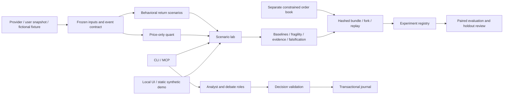

# Architecture

## Numerical core

| Module | Responsibility |
|---|---|
| markets / calendars | Symbol metadata, horizon parsing, exchange schedules and explicit proxies |
| data / snapshots | Provider reads, completed bars, bounded cache, immutable frame/universe receipts |
| indicators / forecast | Causal price features, similar-setup calibration, shrinkage and range |
| events | Versioned return convention, fixed flat band, reference price and loss functions |
| swarm | Regional or generic participant archetypes, conditional return worlds and paired shifts |
| lab | Synthetic scenarios, independent-return baseline, evidence, sensitivity and falsification |
| microstructure | Separate experimental price-time book with cash/inventory reservations and conservation |
| plan / paper | Unit-aware sizing and conservative OHLC execution approximations |
| runs | Frozen numerical inputs, report snapshots, runtime/source hashes, safe import and lineage |
| storage / journal / registry | SQLite transactions, legacy migration, complete-status experiment history |
| evaluation / portfolio | Paired/date-clustered scores, embargoed holdout gates, shock/covariance arithmetic |
| server / cli / demo | Same tool contracts over stdio/CLI; separate loopback UI and standalone export |

## Quant event

For horizon h, historical features use information through each feature date. Labels are
forward log returns whose windows have matured by the cutoff. The flat threshold is
0.25 × rolling 63-session log-return standard deviation × sqrt(h), with at least 40
returns. The same frozen threshold/reference goes into the current event contract.

A score defines similar setups (one historical quintile). Conditional label frequencies
shrink toward unconditional rates using approximate n_eff = n/h and 20 pseudo-observations.
This overlap heuristic does not eliminate serial dependence. Direction requires a
0.08 difference between UP and DOWN. Displayed 80% ranges use max(EWMA, past-year)
volatility and a normal approximation; their volatility is not the event's flat band.

## Two simulation models

The behavioral swarm aggregates participant demand into returns. Group weights, reaction
scale, fair-value pull and persistence are assumptions. It has no cash ledger/order book.
Common random numbers pair baseline/scenario worlds; shift intervals measure sampling
uncertainty conditional on the chosen model, excluding behavioral uncertainty. Group
contributions are simulated log-demand contributions, not observed institutional flows.

The microstructure sandbox has a real synthetic limit-order matching mechanism:
price-time priority, partial fills, cash/inventory reservations, cancellation release,
and ledger conservation. It prevents self trades, borrowing and overselling. Its quotes
and reaction scale are arbitrary and not fitted to an exchange. Do not interpret its
single tape as a probability distribution or real market impact.

## Agents and reports

Twenty-three host-neutral role sources live in roles/. The generator produces host agent
formats and skill references. Analysts can browse only in live research. A host may delegate
or play roles serially according to its capabilities; numerical tools require no agents.

run_begin allocates a UUID workspace and captures settings and available protocol/role
sources. Reports are mutable working files until run_finalize freezes their contents/hashes
into a child bundle. Numeric direction/swarm/scenario calls automatically save frozen
price inputs and runtime/source hashes. Wheels lack repository role sources, so host prompt
receipts are still needed when prompts are unavailable.

Final full-desk decisions must provide original prior, normalized final probabilities,
cited evidence IDs and aggregate deltas. Each class stays within 0.10 of its original
prior, including portfolio-manager changes. Python validates the structure/budget;
factual evidence and reasoning still require human review.

## Intraday

Scans use 5-minute OHLCV, remove off-session/lunch bars and truncate fully closed bars.
Historical universes come from prior local receipts when available; current selection is
explicitly flagged. Historical earnings boosts are disabled. Delayed/stale candidates
abstain from a plan. Premarket targets use venue schedules rather than weekend guesses.

Live continuation is a signed close-to-signal return beyond 0.1 ADR at the close. It is
distinct from a paper win. Paper trades use adverse entry/stop gaps, stop-first ambiguity,
optional supplied costs/slippage and square-off. Pullback confirmation occurs at bar close;
a target touched earlier in that bar cannot count. Real tick order, depth and fills remain
unknown. Intraday provider retention can prevent later grading.

## Evaluation and trust boundaries

Journal scoring uses saved contracts and rebased adjusted daily history. Binary UP scores
use the actual UP event, not any positive return. Multiclass Brier sums the three losses
(0–2); log loss clips probabilities at 1e-12. References use exactly the same rows.

The registry retains forecast/abstained/failed statuses, local hash-chain commitments and
append-only settlements. Cross-source comparisons require matching event contracts and
outcomes. Manual settlements are explicitly unverified. Date-clustered paired intervals
do not fix selection bias or overlapping-horizon dependence. Learning review requires a
later untouched period after all training label_end dates and never changes a model.

Truncation is not archival availability. Yahoo adjusted vintages, current universes and
RSS cannot establish a historically available dataset. Local content hashes are not
external timestamps. A public prospective claim needs externally published commitments,
licensed sources and real elapsed outcomes.

MCP is stdio. The optional loopback UI is single-user, strict Host/Origin and bounded JSON.
Public hosting uses only the static synthetic artifact. There is no broker execution,
authentication or tenant isolation. A manual Pages workflow deploys only the synthetic
static demo; it is not a hosted research API.

## Persistent research workspace (0.3)

`research.py` owns optimistic project revisions, lineage-preserving archives, comparisons
and finite-grid counterexamples. `evidence.py` validates anchored sources and dependency
graphs; retractions mark affected claims for review. `schemas.py` checks imported run
semantics after the content hash. Original immutable receipts are never migrated in place.

`timeline.py` stores append-only information vintages. `arena.py` standardizes shared-event
forecasts and paired moving-block evaluation. `intelligence.py` stores assessments,
outcomes, protocols and unverified witness receipts. `advanced.py` contains bounded
financial baselines. Public contracts are registered by `research_tools.py` in CLI/MCP.

`jobs.py` uses SQLite transactions, idempotency, leases and token-guarded completion.
The local demo owns one worker; crash recovery retries saved inputs after lease expiry.
The dependency-free workspace polls job state and preserves canonical receipt strings.
See [workspace.md](workspace.md) for numerical, data and cancellation limits.
